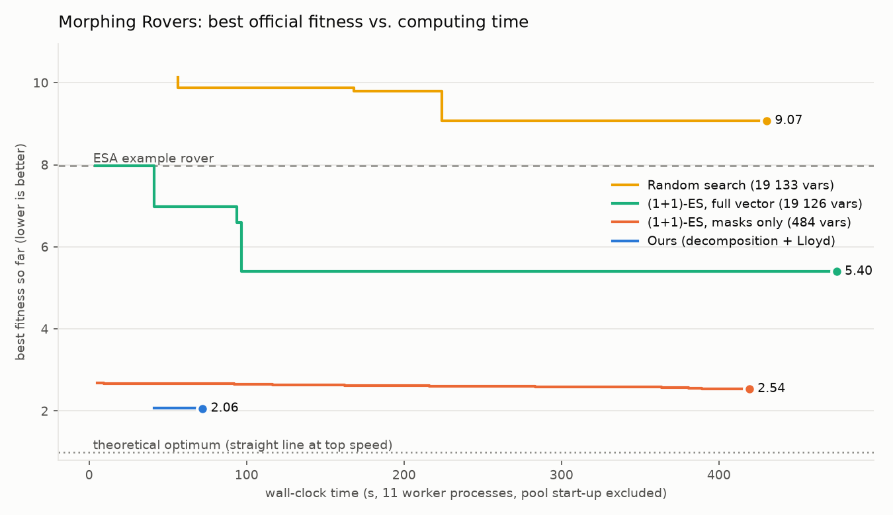
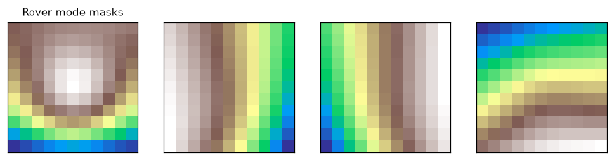
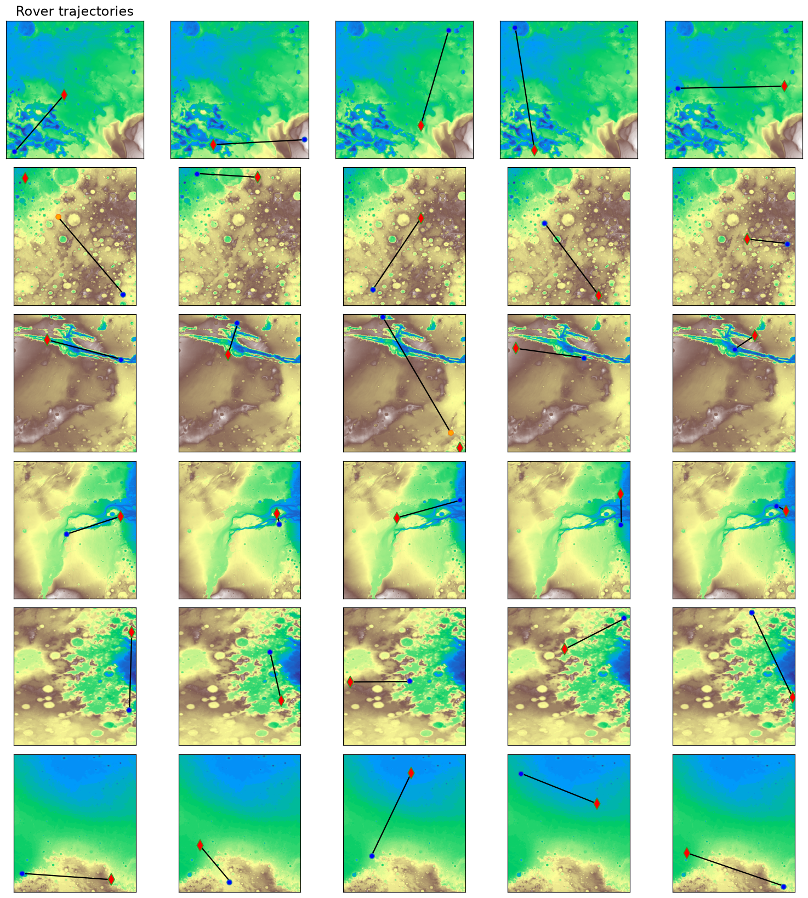

# Morphing Rovers: a fast decomposition algorithm for ESA's SpOC-2 challenge

Course project for **DIZAJNE DHE ALGORITME I TE DHENAVE**.
Problem: [SpOC-2 "Morphing Rovers"](https://optimize.esa.int/challenge/spoc-2-morphing-rovers/p/morphing-rovers)
from ESA's Advanced Concepts Team (GECCO 2023 Space Optimisation Competition).

**Result:** official fitness **2.063**, against **7.98** for ESA's example rover (lower is better, 1.0 is the
theoretical optimum). It takes **13 simulator evaluations and about 2 minutes** on a 12-thread CPU.
Generic black-box optimisers given 100 evaluations each do worse: the best of them reaches 2.54 after
7 minutes (see [Results](#4-results)).



---

## 1. The problem in one paragraph

One rover design is sent to 30 landing sites on 6 Mars-like height maps and must reach a sample at each
within 500 time steps. The rover can morph between **4 forms**. A form is an 11 x 11 mask, and the rover is
fast where the terrain under it looks like the mask. A **neural network** (2 conv layers, 3 dense layers,
recurrence) steers the rover and decides when to morph. The decision vector has **19 133 variables**:
484 mask values, 18 642 network weights and biases, and 7 integer architecture choices. Fitness is the
mean over scenarios of `(T / T_min) * (1 + d / d0)`. Scoring one design means simulating all 30 routes,
which takes **~30 s** with ESA's code (~3.3 s on 11 processes).

## 2. The algorithm

Reading the simulator showed that the problem is not really a 19 133-dimensional black box. It splits
into three sub-problems, each with a classic algorithm (`rovers/`):

### Stage 1: steering by construction (no search, O(1)) - `controller.py`
The network's input already contains the bearing to the target, `s[2] = bearing / pi`. With Hardtanh
activations (the identity on [-1, 1]), four weights of 1 route that value to the steering output, and an
output gain of 4 gives

```
turn = clamp(bearing, -pi/4, +pi/4)      # exact pure pursuit: face the target, drive straight
```

The morph output gets a constant bias of +1: "morph whenever allowed". The **simulator itself** then picks
the fastest form for the current terrain. All other 18 600+ weights are zero.

### Stage 2: forms by clustering (Lloyd / k-means) - `terrain.py`, `masks.py`
Because the rover drives straight at the target, the terrain it will cross is known in advance. We sample
the 11 x 11 terrain patch every 6 px along the 30 routes (8 262 patches), using ESA's own
`extract_local_view`. Choosing 4 forms then becomes **k-means with k = 4**, using the official velocity
function `V` as the similarity:

```
minimise  J(F1..F4) = mean_j  1 / max_i V(F_i, T_j)        (∝ total driving time)
```

- seeding: **k-means++** (sample proportional to squared extra time)
- assign: each **window of 10 consecutive patches** goes to its fastest form. Windows model the 9-step
  morphing cooldown, during which the rover cannot change form
- update: each form minimises its cluster's mean `1/V` (gradient steps, accepted only if they improve)
- J never increases and J ≥ 1, so the algorithm converges. Best of 4 restarts.

### Stage 3: Lloyd with the simulator in the loop - `refine.py`
The real rover picks its form one step before using it, and the cooldown means it is not always in the
best form. So the **official simulator does the assignment step**. We log which form was actually used on
which patch, refit each form to *that* terrain, and take a damped step (step sizes 1, 1/2, 1/4, scored in
one parallel batch). A step is kept only if the official fitness improves, so the result is monotone and
never worse than stage 2.

Finally the vector is verified with ESA's unmodified `udp.fitness(x)`.

## 3. Why this algorithm and not another

The full comparison is in **[docs/ADR-001-algorithm-choice.md](docs/ADR-001-algorithm-choice.md)**. In short:

| Approach | Why not chosen |
|---|---|
| GA / Differential Evolution / PSO on all 19 133 variables | need 10^4–10^6 evaluations at 3.3 s each, i.e. hours to weeks; random networks barely move towards the target |
| CMA-ES | full covariance for 19 126 floats = 2.9 GB and O(n³) updates; large-scale variants still need ~10^4+ evaluations |
| Reinforcement learning / backpropagation | form choice (`argmax`), cooldown and pixel rounding are not differentiable; RL needs millions of 4 ms steps |
| A* / Dijkstra path planning | a reactive network with an 89 x 89 view cannot store a global route; useful only as an analysis tool |
| **Decomposition + Lloyd (ours)** | uses the problem's structure. Only 13 simulations; each stage is exact, convergent or monotone |

Black-box methods spend their budget rediscovering what the simulator already provides (the bearing to
the target, and automatic choice of the best form). When one evaluation costs seconds, **the number of
evaluations decides the speed**, and decomposition cuts it by orders of magnitude.

## 4. Results

All numbers are ESA's official fitness, computed locally (lower is better). Every method used the same
11-process worker pool, and pool start-up is excluded for all of them. "Ours" includes terrain sampling,
clustering and refinement.

| Method | Variables searched | Official evaluations | Wall-clock | Best fitness |
|---|---|---|---|---|
| ESA example rover (reference) | - | 1 | - | 7.984 |
| Random search | 19 133 | 100 | 430 s | 9.071 |
| (1+1)-ES, full chromosome (from ESA's example) | 19 126 | 100 | 475 s | 5.399 |
| (1+1)-ES, masks only (with our controller) | 484 | 100 | 419 s | 2.538 |
| **Ours: decomposition + Lloyd + simulator-in-the-loop Lloyd** | structured | **13** | **72 s** | **2.063** |

Our rover reaches **28 of the 30 samples**. The two misses are the two longest routes (about 3 500 px),
where it runs out of its 500 steps with 33% and 12% of the distance left.

Even a black-box search in the *same reduced space* as ours (masks only, our controller) is clearly
behind after 8x more simulations. That isolates the value of the clustering algorithm itself, not just
of the decomposition.

Ablation of the pipeline:

| Pipeline so far | Fitness |
|---|---|
| ESA example rover | 7.98 |
| Stage 1 only (analytic controller, flat forms of all ones) | 2.69 |
| + Stage 2, per-patch clustering | 2.19 |
| + Stage 2, per-window clustering (models the cooldown) | 2.075 |
| + Stage 3, simulator-in-the-loop Lloyd (**final**) | **2.063** |

Per-scenario scores are in [results/summary.json](results/summary.json). The four forms and the 30
trajectories, drawn with ESA's own plotting code:




### Complexity

| Stage | Time complexity | Measured |
|---|---|---|
| 1. controller | O(1) | < 1 ms |
| 2a. terrain sampling | O(L / Δ) view extractions (L = total route length, Δ = 6 px) | 1 s |
| 2b. Lloyd clustering | O(R · I · (n·k·d + k·S·n_i·d)), with n = 8 262, k = 4, d = 121, R = 4, S = 150 | 37 s |
| 3. refinement | ≤ 1 + 3·iterations official evaluations | 13 evaluations, 45 s |
| black-box baseline | O(E · C_sim), with E = 10^3–10^5 evaluations and C_sim ≈ 3.3 s | hours to days |

## 5. How to run

```bash
git clone <this repository> && cd morphing-rovers
python -m venv .venv && .venv/Scripts/activate        # Windows (Linux/macOS: source .venv/bin/activate)
pip install -r requirements.txt --extra-index-url https://download.pytorch.org/whl/cpu
python scripts/fetch_challenge.py      # downloads ESA's evaluation code + maps (pinned commit)
python solve.py                        # ~2 min -> results/solution.npy, results/summary.json
python -m unittest discover -s tests -v
python benchmarks/compare.py --evals 100   # optional, ~25 min: black-box baselines + chart
python benchmarks/compare.py --plot-only   # redraw the chart from results/benchmark.json
python benchmarks/plot_solution.py         # optional: forms + trajectories figures
```

To check a solution with the plain official code: `udp.fitness(np.load("results/solution.npy"))`.

> **Windows tip:** PyTorch has deep file paths. If `pip` fails with "No such file or directory", create the
> virtual environment in a short folder, e.g. `python -m venv C:\venvs\rovers`.

## 6. Repository layout

```
solve.py                    the full pipeline (stages 1-3 + official verification)
rovers/official.py          loads ESA's unmodified code; parallel evaluator (30 scenarios over N processes)
rovers/chromosome.py        named views into the 19 133-element vector (layout read from ESA's network)
rovers/controller.py        stage 1: analytic pure-pursuit controller
rovers/terrain.py           stage 2a: terrain patches along the routes
rovers/masks.py             stage 2b: Lloyd / k-means++ with the official velocity function
rovers/refine.py            stage 3: simulator-in-the-loop Lloyd with line search
benchmarks/compare.py       random search, (1+1)-ES on full vector and on masks, convergence chart
benchmarks/plot_solution.py ESA's plots for a solution
tests/test_rovers.py        checks against the official code (velocity, network, bounds, clustering)
docs/ADR-001-...md          the algorithm decision record
results/                    solution.npy, summary.json, benchmark.md, figures
```

## 7. Notes and limitations

- **ESA's files are not included.** Their repository has no licence, so `scripts/fetch_challenge.py`
  downloads them from [github.com/esa/SpOC2](https://github.com/esa/SpOC2) at a pinned commit.
- **NumPy 2 compatibility.** ESA's 2023 code crashes under NumPy 2 + current torchvision: the rover angle
  becomes float32 and `rotate` rejects it. `rovers/official.py` restores the original float64 arithmetic
  when it imports the module. ESA's file is not edited. ESA's own server may differ from these local
  scores in the last digits.
- **Straight-line assumption.** The rover always drives straight at the sample. Terrain-aware detours would
  need the convolutional part of the network, which is left at zero. Future work: a low-dimensional
  black-box search (e.g. sep-CMA-ES) over those weights, **warm-started from this solution**.

## Credits

Problem, simulator and data: ESA Advanced Concepts Team, SpOC 2023. Height maps derived from NASA MOLA MEGDR.
