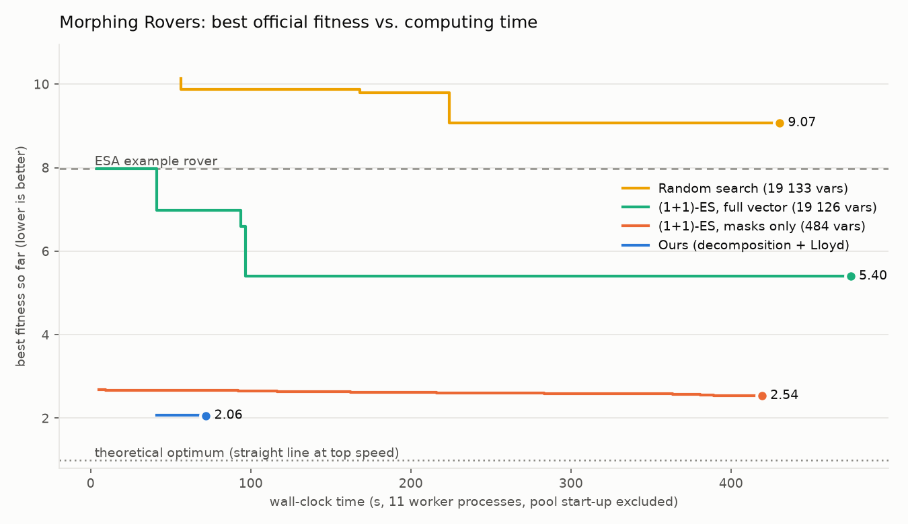

# ADR-001: Algorithm for SpOC-2 "Morphing Rovers"

**Status:** Accepted
**Date:** 2026-11-09
**Deciders:** project author; reviewed by the course instructor

## Context

The task is ESA's [SpOC-2 Morphing Rovers](https://optimize.esa.int/challenge/spoc-2-morphing-rovers/p/morphing-rovers)
challenge (GECCO 2023). One rover design must drive from 30 landing sites to 30 samples on six Mars-like
height maps. A design is one decision vector `x` with **19 133 variables**:

| Part | Size | Type |
|---|---|---|
| 4 rover forms (11 x 11 masks) | 484 | float in [-100, 100] (centres > 0) |
| neural-network biases + weights | 18 642 | float in [-100, 100] |
| pooling / activation choices | 7 | integer |

Fitness is the mean over 30 scenarios of `(T / T_min) * (1 + d / d0)`, where 1.0 is the unreachable ideal
(straight line at top speed). It is a **black-box simulation**. Each scenario runs up to 500 steps, and each
step rotates an 89 x 89 terrain window and runs a small CNN. We measured these costs on the development
machine (12 logical CPUs):

| Measurement | Value |
|---|---|
| one official `udp.fitness(x)` call, 1 process | **~30 s** |
| same, 30 scenarios on 11 worker processes | **~3.3 s** |
| ESA's example rover | fitness **7.98** |

The course asks for the **best and fastest** algorithm and a justification against the alternatives.

### What we found when reading the simulator

These facts shape the whole decision:

1. **The network already receives the bearing to the target.** State element `s[2] = angle_to_target / pi`.
   A hidden layer with Hardtanh activation is the identity on [-1, 1], so this value can be carried through
   the network unchanged. Four weights equal to 1 plus an output gain of 4 give the exact steering law
   `turn = clamp(bearing, -pi/4, pi/4)`. This is pure pursuit in a straight line, with no training at all.
2. **The simulator chooses the form, not the network.** When the network outputs `m_s > 0` and the cooldown
   is over, the simulator switches to the fastest of the four forms on the current terrain. So the network
   only decides *when* to morph. A constant positive bias means "whenever allowed".
3. **With straight-line driving, the terrain is known in advance.** The rover always faces the target, so
   the 11 x 11 patches it meets depend only on geometry, not on the forms. Designing the forms therefore
   becomes a **clustering problem**: pick 4 "centres" that minimise the mean of `1 / max_i V(F_i, T_j)`,
   where `V` is the official velocity function. That mean is proportional to driving time.
4. **Morphing is delayed and rationed.** The form chosen on the current patch is first used on the next
   one, and every morph locks the rover in that form for 9 steps. Plain per-patch clustering ignores this.
   It predicted fitness 1.45 but scored 2.19 in the real simulator.

## Decision

Use a **decomposition algorithm** that turns the 19 133-variable black-box problem into three structured
sub-problems, each solved with a classic algorithm:

| Stage | Sub-problem | Algorithm | Cost |
|---|---|---|---|
| 1 | steering + morph timing | **closed-form construction** of the network weights (pure pursuit) | O(1), no search |
| 2 | 4 rover forms | **Lloyd's algorithm (k-means)** with k-means++ seeding. Distance = official velocity function. Assignment = per window of 10 consecutive patches, which models the cooldown | 8 262 patches, ~37 s |
| 3 | forms under the real morphing rules | **Lloyd with the simulator doing the assignment**, plus a damped line-search step (elitist, so the score never gets worse) | 13 official evaluations, ~45 s |

The final vector is checked with ESA's unmodified `udp.fitness(x)`.

## Options considered

### Option A: Genetic algorithm / Differential Evolution / PSO on the full vector

| Dimension | Assessment |
|---|---|
| Complexity | Low (pygmo has them all) |
| Cost | Very high: population x generations evaluations, typically 10^4 to 10^6 at 3.3 s each, so 9 hours to 38 days |
| Scalability | Poor: in 19 133 dimensions, crossover and mutation almost never land in the tiny region of weight space that steers sensibly |
| Fit to the problem | Ignores all structure; most random networks drive in circles or leave the map |

**Pros:** general-purpose; handles the 7 integer genes naturally.
**Cons:** needs orders of magnitude more simulations than the time budget allows. Our benchmark shows that
100 evaluations of random search and of a (1+1)-ES on the full vector do not get anywhere near our result
(see Results).

### Option B: CMA-ES (and its large-scale variants)

| Dimension | Assessment |
|---|---|
| Complexity | Medium |
| Cost | Full CMA-ES: a 19 126 x 19 126 covariance matrix = **2.9 GB** in float64, O(n^2) per sample and an O(n^3) ≈ 7·10^12-flop eigendecomposition per update. Default population = 4 + 3 ln n ≈ 33, and it typically needs on the order of 10^4–10^5 evaluations in this dimension |
| Scalability | Separable / limited-memory variants (sep-CMA, LM-CMA) fix the memory, but not the evaluation count |
| Fit to the problem | Excellent local optimiser in low dimension; wasted on 18 642 network weights that our analysis shows can be written by hand |

**Pros:** best-in-class black-box optimiser for smooth, continuous, moderate-dimensional problems.
**Cons:** infeasible at full dimension. At 484 dimensions (masks only) it is feasible but still black-box:
the (1+1)-ES in our benchmark searches that same 484-dimensional space and reaches 2.538 after 100
simulations, while Lloyd needs 13 to reach 2.0628.

### Option C: Reinforcement learning (PPO) or back-propagation through the simulator

| Dimension | Assessment |
|---|---|
| Complexity | High (environment wrapper, reward shaping, hyper-parameter tuning) |
| Cost | PPO typically needs 10^6–10^7 environment steps. The official step costs ~4 ms, so 1–11 hours of single-core simulation before tuning |
| Fit to the problem | The form choice (`argmax`), the cooldown counter, the rounding of positions to pixels and early termination are **not differentiable**, so back-propagation through the simulator is not directly possible |

**Pros:** could, in principle, learn terrain-aware detours using the CNN.
**Cons:** slowest option; results are seed-sensitive and hard to explain or reproduce for a course project.

### Option D: Global path planning (Dijkstra / A*) on a terrain cost map

| Dimension | Assessment |
|---|---|
| Complexity | Medium |
| Cost | Cheap: O(V log V) per map |
| Fit to the problem | **Not representable.** The rover is a reactive network that sees only an 89 x 89 window around itself and the bearing to the target. A global route cannot be stored in its weights. Speed also depends on the forms, which are themselves being designed |

**Pros:** gives a useful lower bound on how much a detour could save.
**Cons:** does not produce a valid chromosome.

### Option E (chosen): decomposition + Lloyd's algorithm

| Dimension | Assessment |
|---|---|
| Complexity | Medium: three small, separately testable stages |
| Cost | **13 official evaluations, ~2 minutes** in total (including worker start-up and verification) |
| Scalability | Linear in the number of terrain patches: O(R · I · n · k · d) for clustering, with n = 8 262, k = 4, d = 121, R = 4 restarts, I ≤ 30 iterations |
| Fit to the problem | Uses all four facts above; every stage has a convergence argument |

**Pros:** fastest by orders of magnitude; best fitness in our benchmark; deterministic for a given seed; every
stage is explainable (closed-form controller, k-means, monotone line search).
**Cons:** assumes straight-line driving. Terrain-aware detours, which only the CNN path could learn, are
left unexplored (see Consequences).

## Trade-off analysis

The core trade-off is **generality vs. exploiting structure**. Black-box methods (A, B, C) make no
assumptions, so they spend their whole budget rediscovering things the simulator already tells us: steer
towards the target, and let the simulator pick the form. Because one evaluation costs 3.3 s even in
parallel, the number of evaluations dominates the total time. A method that needs 10^4 evaluations cannot
be "the fastest", however efficient each step is.

Decomposition gives up a little generality (no detours) to replace almost all simulations with cheap
computations on terrain patches: clustering 8 262 patches with the velocity function costs microseconds
per patch, against ~4 ms per simulated step. The simulator is used only where the model is known to be
wrong, namely the morphing delay and cooldown, and there the same Lloyd structure (assign, then update)
is kept, with the simulator doing the assignment.

Correctness arguments, as expected in an algorithms course:

- **Stage 1 is exact by construction.** Unit tests check `steer = clamp(4 * bearing / pi, -1, 1)` against
  the official network.
- **Stage 2 converges.** The assignment step chooses the best form for each window, so the cost J cannot
  rise. The update step only accepts a new form if it lowers that cluster's cost. J is bounded below by 1,
  so the sequence converges, as in the classic k-means proof.
- **Stage 3 is monotone.** A step is accepted only if the official fitness improves (elitist line search
  over step sizes 1, 1/2, 1/4), so the result can only improve on stage 2.

## Results (official fitness, lower is better)

Measured with ESA's simulator on the same 11-process pool, 100 official evaluations per black-box method
(pool start-up excluded for every method):

| Method | Variables searched | Official evaluations | Wall-clock | Best fitness |
|---|---|---|---|---|
| ESA example rover (reference) | - | 1 | - | 7.984 |
| Random search | 19 133 | 100 | 430 s | 9.071 |
| (1+1)-ES, full chromosome (from ESA's example) | 19 126 | 100 | 475 s | 5.399 |
| (1+1)-ES, masks only (with our controller) | 484 | 100 | 419 s | 2.538 |
| **Option E (chosen)** | structured | **13** | **72 s** | **2.063** |

The chosen design reaches 28 of the 30 samples. The two misses are the two longest routes (~3 500 px),
which run out of the 500 steps with 33% and 12% of the distance left.

Ablation of our own stages:

| Pipeline so far | Fitness |
|---|---|
| ESA example rover | 7.98 |
| Stage 1 only (analytic controller, flat forms of all ones) | 2.69 |
| + stage 2, per-patch clustering (ignores the cooldown) | 2.19 |
| + stage 2, per-window clustering (window = 10 patches) | 2.075 |
| + stage 3, simulator-in-the-loop Lloyd (final) | **2.063** |
| Hysteresis switching ("morph only below τ") instead of "always morph" | no gain (2.11–2.12) |

## Consequences

- **Easier:** reproducing the result (one command, ~2 minutes), explaining it, and testing each stage on
  its own (`tests/`).
- **Harder:** gaining more from forms alone. With straight-line driving, the remaining gap between the
  model's window-clustering cost (1.91) and the achieved 2.06 comes from the morphing delay. The gap to 1.0
  comes from rough terrain that no set of 4 forms covers well.
- **To revisit:** terrain-aware steering. The CNN path is still all zeros. A natural next step is a
  low-dimensional black-box search (for example sep-CMA-ES on the conv and steering weights only),
  **started from our solution instead of from random**. That would combine this ADR's speed with Option
  B's ability to discover detours.
- **Environment note:** ESA's 2023 code assumes NumPy 1.x. Under NumPy 2 it crashes in `rotate` (float32
  angle). `rovers/official.py` restores the original float64 arithmetic at import time, without editing
  ESA's file. ESA's own server may differ from these local scores in the last digits.

## Action items

1. [x] Fetch ESA's files at a pinned commit (`scripts/fetch_challenge.py`)
2. [x] Stage 1 analytic controller + unit tests against the official network
3. [x] Stage 2 Lloyd clustering with window assignment
4. [x] Stage 3 simulator-in-the-loop Lloyd with line search
5. [x] Benchmark against random search and (1+1)-ES at an equal evaluation budget
6. [ ] Optional: submit `results/solution.npy` to the Optimise platform with ESA's submission helper
7. [ ] Optional: terrain-aware steering, warm-started from this solution
